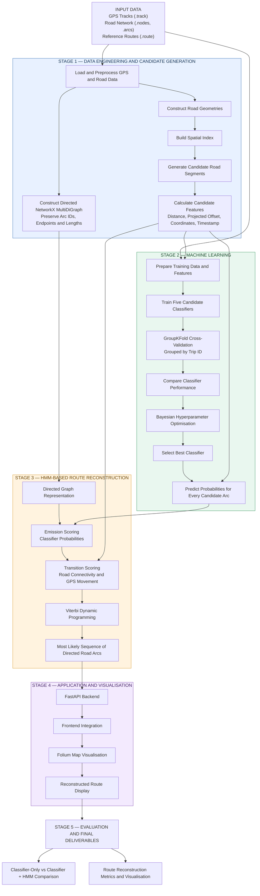
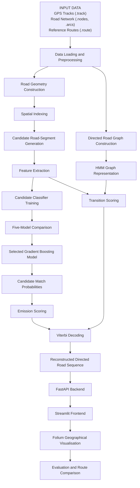

<<<<<<< HEAD

# PathSnap
### Distributed Map-Matching & Route Reconstruction Using Machine Learning

## 1. Problem Statement

GPS-based vehicle tracking systems frequently produce inaccurate and noisy location observations due to GPS measurement errors, signal interference, urban environments, and irregular sampling intervals.

As a result, recorded GPS coordinates may not accurately represent the actual road segments travelled by a vehicle. A GPS observation may appear on a nearby parallel road, outside the road network, or at an incorrect position.

Traditional nearest-road matching approaches independently assign each GPS observation to its geographically closest road segment. However, the closest road is not necessarily the road actually travelled. Such approaches can produce disconnected routes, unrealistic turns, and incorrect road assignments.

**PathSnap aims to address this problem by developing a machine-learning-based map-matching system that reconstructs the most likely sequence of directed road segments travelled by a vehicle from noisy GPS trajectories and an underlying road network.**

The system combines candidate road-segment generation, machine learning-based candidate relevance estimation, and Hidden Markov Model (HMM)-based sequence decoding to produce geographically and topologically plausible route reconstructions.

The primary objective is to improve route reconstruction by considering both the relevance of individual road candidates to GPS observations and the feasibility of movement between consecutive road segments.

---

## 2. Project Objectives

- Process noisy and irregular GPS trajectories.
- Represent the underlying road network as a directed graph.
- Identify multiple candidate road segments for each GPS observation.
- Extract relevant spatial and movement-related features.
- Train and compare five machine learning classifiers for candidate relevance estimation.
- Perform GroupKFold cross-validation to avoid trip-level data leakage.
- Apply Bayesian Hyperparameter Optimisation for model tuning.
- Implement an HMM-based decoder combining emission and transition scores.
- Use the Viterbi algorithm to identify the most likely sequence of road segments.
- Compare classifier-only predictions against classifier + HMM route reconstruction.
- Provide route visualisation through an interactive map interface.

---

## 3. Understanding the Map-Matching Problem

The system receives two primary sources of information:

### 3.1 GPS Trajectories

GPS observations are obtained from `.track` files.

Each observation contains:

- Longitude
- Latitude
- Timestamp

These observations represent the recorded positions of a moving vehicle over time.

However, GPS coordinates may contain positional errors and may not lie exactly on the actual road travelled.

### 3.2 Road Network

The road network is represented using:

| Dataset File | Description |
|---|---|
| `.nodes` | Contains road-network node coordinates. |
| `.arcs` | Contains directed connections between road-network nodes. |
| `.route` | Contains the reference sequence of road arc IDs for a trip. |

Each directed road segment is identified using its original zero-based row index from the `.arcs` file.

The road network preserves directionality, meaning that travelling from node A to node B does not automatically imply that travelling from B to A is permitted.

### 3.3 Core Challenge

For a given GPS observation, multiple nearby road segments may be plausible candidates.

The geographically closest candidate may not be the correct one.

Therefore, PathSnap does not independently select the nearest road for every GPS point. Instead, it considers:

1. How closely a candidate road matches the GPS observation.
2. Whether movement from the previous candidate to the current candidate is feasible.
3. Whether the complete sequence forms a plausible route through the directed road network.

---

## 4. System Architecture and Workflow

PathSnap follows a multi-stage pipeline combining data engineering, machine learning, probabilistic sequence decoding, and application development.



---

## 5. Detailed Working of the System

### Stage 1: Data Engineering and Candidate Generation

**Responsible: Shayna Zaidi Gupta**

The first stage prepares the GPS trajectories and underlying road network for map matching.

The GPS tracks and road-network files are loaded and processed to construct road geometries and a spatially searchable road network.

For each GPS observation, nearby road segments are identified as candidate arcs.

Instead of selecting only the closest road segment, multiple candidates are retained for subsequent evaluation.

The candidate-generation pipeline includes:

1. Loading and preprocessing GPS tracks, nodes and arcs.
2. Constructing road geometries from road-network coordinates.
3. Calculating the length of each directed road segment in metres.
4. Building a spatial index for efficient nearby-road searches.
5. Generating candidate road segments for every GPS observation.
6. Calculating the perpendicular distance between GPS observations and candidate roads.
7. Calculating the projected position along each candidate road segment.
8. Constructing a directed NetworkX `MultiDiGraph`.

The candidate DataFrame will contain:

| Attribute | Description |
|---|---|
| `trip_id` | Unique identifier of the trip. |
| `obs_idx` | Original zero-based GPS observation index. |
| `timestamp` | GPS observation timestamp. |
| `longitude` | GPS longitude. |
| `latitude` | GPS latitude. |
| `candidate_arc_id` | Original zero-based road arc ID. |
| `distance_m` | Perpendicular distance from GPS point to candidate road. |
| `projected_offset_m` | Distance along the directed road arc from its starting node to the projected GPS position. |

The road graph retains:

- Original arc IDs.
- Starting and ending node IDs.
- Directed connectivity.
- Road-segment lengths.

A NetworkX `MultiDiGraph` is used to preserve multiple directed road segments between the same pair of nodes without losing their individual identities.

### Stage 2: Machine Learning-Based Candidate Relevance Estimation

**Responsible: Sangadala Yeasaswani**

After candidate generation, the system must estimate how relevant each candidate road segment is to its corresponding GPS observation.

Five machine learning classifiers will be trained and compared:

1. Logistic Regression
2. K-Nearest Neighbours (KNN)
3. Decision Tree
4. Random Forest
5. HistGradientBoosting

The models use candidate-level features to estimate the relevance of each candidate road segment.

The training workflow includes:

- Feature preparation and preprocessing.
- Training five candidate classifiers.
- GroupKFold cross-validation using trip IDs as groups.
- Performance comparison using appropriate classification metrics.
- Bayesian Hyperparameter Optimisation of the selected model.
- Final model evaluation and artifact export.

**Hyperparameter optimisation requirement:**

Bayesian Hyperparameter Optimisation is mandatory. Grid Search and Random Search are not used.

Model training, cross-validation and hyperparameter optimisation are primarily performed using Google Colab.

The trained classifier produces a probability for every candidate road segment rather than returning only the highest-ranked candidate.

The prediction interface is:

`predict_candidates(candidate_df)`

The output DataFrame contains:
=======
# PathSnap — GPS Map Matching and Route Reconstruction Using Machine Learning

## 1. Project Overview

PathSnap is a machine-learning-based GPS map-matching and route reconstruction system that converts noisy GPS trajectories into geographically and topologically plausible sequences of directed road segments.

GPS-based vehicle tracking systems frequently produce inaccurate location observations due to measurement errors, signal interference, urban environments and irregular sampling intervals.

Consequently, recorded GPS coordinates may not accurately represent the actual road travelled by a vehicle. An observation may appear on a nearby parallel road, outside the road network or at an incorrect position.

Traditional nearest-road matching approaches independently assign each GPS observation to its geographically closest road segment. However, the closest road is not necessarily the road actually travelled. This can produce disconnected routes, unrealistic turns and incorrect road assignments.

**PathSnap addresses this problem by combining candidate road-segment generation, machine-learning-based candidate relevance estimation and Hidden Markov Model (HMM)-based sequence decoding.**

The system considers both the relevance of individual road candidates to GPS observations and the feasibility of movement between consecutive road segments.

### Key Features

- GPS trajectory preprocessing and analysis.
- Directed road-network representation.
- Candidate road-segment generation.
- Spatial and movement-based feature extraction.
- Training and comparison of multiple machine learning classifiers.
- GroupKFold cross-validation using trip IDs.
- Candidate match-probability estimation.
- HMM-based emission and transition scoring.
- Viterbi decoding for route reconstruction.
- FastAPI backend for reconstruction requests.
- Streamlit frontend for interactive application access.
- Folium-based geographical visualisation.
- Quantitative comparison of classifier-only predictions and HMM-decoded routes.

## 2. Problem Statement

Given a sequence of noisy GPS observations and an underlying directed road network, the objective is to identify the most likely sequence of road segments travelled by a vehicle.

The problem involves three major challenges:

1. **GPS uncertainty:** Recorded coordinates may not lie directly on the road travelled.
2. **Candidate ambiguity:** Multiple nearby road segments may be plausible matches for one observation.
3. **Route continuity:** Independently selecting the highest-probability road candidate can produce disconnected or physically implausible routes.

PathSnap addresses these challenges through a multi-stage pipeline that combines spatial candidate generation, machine learning and probabilistic sequence decoding.

### Map Matching vs Shortest-Path Routing

| Map Matching | Shortest-Path Routing |
|---|---|
| Infers the road actually travelled | Finds a route between locations |
| Uses observed GPS trajectories | Uses source and destination |
| Handles GPS measurement noise | Optimises a route according to a cost |
| Reconstructs likely road segments | Calculates an optimal path |

PathSnap focuses on reconstructing the most likely observed route rather than finding the shortest possible route.

## 3. Dataset Understanding

The project uses GPS trajectory data and a corresponding directed road network.

### 3.1 Dataset Files

| File | Description |
|---|---|
| `.track` | GPS observations containing longitude, latitude and timestamps |
| `.nodes` | Road-network node identifiers and coordinates |
| `.arcs` | Directed connections between road-network nodes |
| `.route` | Reference sequence of road arc IDs associated with a trip |

Each directed road segment is identified using its original zero-based row index in the `.arcs` file.

The road network preserves directionality. An arc from node A to node B does not automatically imply that movement from B to A is permitted.

### 3.2 Dataset Partitions

The project distinguishes between the following data partitions:

- **Training data:** Used for feature preparation, model training and cross-validation.
- **Student-testing data:** Used for evaluating model performance on held-out trips.
- **Evaluator-testing data:** Reserved for final inference and evaluation. Its hidden reference routes must not be used during training or hyperparameter selection.

Preprocessed candidate data is stored separately from raw dataset files.

The exact dataset counts and partition sizes should be documented using the final repository's actual data.

## 4. System Architecture and Workflow

PathSnap follows a multi-stage architecture combining data engineering, machine learning, probabilistic sequence decoding and application development.



### Overall Processing Pipeline

1. Load and preprocess GPS trajectories and road-network data.
2. Construct directed road geometries and graph representations.
3. Generate nearby candidate road segments for each GPS observation.
4. Extract spatial and movement-related features.
5. Train and compare candidate classification models.
6. Generate candidate match probabilities using the selected classifier.
7. Calculate HMM emission and transition scores.
8. Apply Viterbi decoding to identify the most likely sequence of directed road arcs.
9. Return the reconstructed route through the backend.
10. Visualise and evaluate the reconstructed trajectory.

## 5. Detailed Implementation

### 5.1 Data Engineering and Candidate Generation

The first stage prepares the GPS trajectories and underlying road network.

The processing pipeline includes:

1. Loading GPS tracks, nodes and directed arcs.
2. Processing coordinates and timestamps.
3. Constructing road geometries from road-network coordinates.
4. Calculating road-segment lengths.
5. Building a spatial index for efficient nearby-road searches.
6. Generating candidate road segments for each GPS observation.
7. Calculating perpendicular distances and projected positions along candidate roads.
8. Constructing a directed NetworkX `MultiDiGraph`.

Multiple candidate road segments are retained instead of immediately selecting the nearest road.

The candidate-generation configuration, including search radius and maximum candidate count, is recorded in the implementation.

#### Candidate Data Schema

The candidate DataFrame contains fields such as:

| Attribute | Description |
|---|---|
| `trip_id` | Unique trip identifier |
| `obs_idx` | Original zero-based GPS observation index |
| `timestamp` | GPS observation timestamp |
| `longitude` | GPS longitude |
| `latitude` | GPS latitude |
| `candidate_arc_id` | Original zero-based road arc ID |
| `distance_m` | Perpendicular distance from GPS point to candidate road |
| `projected_offset_m` | Distance along the directed road arc to the projected position |

The road graph preserves original arc IDs, node endpoints, directed connectivity and road-segment lengths.

A NetworkX `MultiDiGraph` allows multiple directed road segments between the same pair of nodes without losing their individual identities.

### 5.2 Feature Extraction

The candidate-generation pipeline is followed by feature extraction.

The model uses spatial and movement-related information to determine how relevant each candidate road segment is to a GPS observation.

The documented feature set includes:

| Feature | Description |
|---|---|
| `distance_m` | Distance between the GPS observation and candidate road |
| `heading_diff` | Angular difference between GPS movement direction and road direction |
| `speed_mps` | Estimated movement speed |
| `bearing` | Direction of GPS movement |
| `projected_offset_m` | Projected position along the candidate arc |
| `arc_length_m` | Total length of the candidate arc |
| `remaining_distance_m` | Remaining distance along the candidate arc |
| `offset_ratio` | Relative position along the candidate arc |
| `time_delta_s` | Time difference between consecutive GPS observations |
| `gps_displacement_m` | Distance between consecutive GPS observations |
| `candidate_heading_deg` | Direction of the candidate road |
| `heading_missing` | Indicator for unavailable heading information |

These features provide the classifier with information about spatial proximity, directional compatibility, road geometry and movement consistency.

### 5.3 Training Labels and Route Alignment

The training data contains a binary target called `is_match`.

- `1`: Candidate considered a matching road segment.
- `0`: Candidate considered a non-matching road segment.

Reference route information is used during training-data preparation to construct candidate labels.

Because GPS observations and reference road arcs do not necessarily have a one-to-one correspondence, route alignment must respect the order of progression through the reference route.

The alignment procedure uses monotone dynamic programming to establish consistent candidate-to-route relationships.

The `.route` sequence must not be matched row-by-row directly with GPS observations.

### 5.4 Machine Learning-Based Candidate Classification

The machine learning stage estimates the relevance of each candidate road segment to its corresponding GPS observation.

Five baseline classifiers are considered:

1. Logistic Regression.
2. K-Nearest Neighbours (KNN).
3. Decision Tree.
4. Random Forest.
5. Gradient Boosting.

The models are compared using appropriate classification and candidate-ranking metrics.

#### Training and Evaluation Strategy

The training workflow includes:

- Feature preparation.
- Model training.
- Five-fold GroupKFold cross-validation.
- Grouping by `trip_id`.
- Model comparison.
- Selection of the final baseline classifier.
- Model and metadata export.

GroupKFold ensures that observations from the same trip do not appear in both the training and validation partitions of a fold.

This reduces trip-level data leakage.

#### Selected Model: Gradient Boosting

Gradient Boosting is selected as the final baseline model based on the reported experimental comparison.

Gradient Boosting is an ensemble learning algorithm that builds decision trees sequentially. Each subsequent learner attempts to reduce errors made by the existing ensemble.

The model can capture nonlinear relationships between GPS observations and road-candidate features.

The baseline configuration documented in the training notebook is:

| Hyperparameter | Value |
|---|---:|
| `n_estimators` | 100 |
| `learning_rate` | 0.1 |
| `max_depth` | 3 |
| `random_state` | 42 |

No Bayesian hyperparameter optimisation is claimed for this baseline implementation.

The final artifact path and exact model class must correspond to the model actually exported by the training workflow.

#### Candidate Probability Prediction

The selected classifier generates candidate match probabilities rather than returning only a binary prediction.

Conceptually:

`predict_candidates(candidate_df)`

The prediction output preserves:
>>>>>>> origin/main

- `trip_id`
- `obs_idx`
- `candidate_arc_id`
- `probability`

<<<<<<< HEAD
Probabilities are normalised across the candidates belonging to each GPS observation.

These probabilities are subsequently supplied to the HMM decoder.

### Stage 3: Hidden Markov Model-Based Route Reconstruction

**Responsible: Shreya Shenoy**

The HMM decoder is responsible for reconstructing the most likely sequence of road segments using classifier probabilities and road-network movement information.

The actual road segment occupied by the vehicle at each observation is treated as a hidden state, while GPS coordinates and timestamps represent the observations.

The decoder consists of four major components.

#### 3.1 Directed Graph Representation — `graph.py`

The directed graph represents the road network using nodes and directed arcs.

It provides:
=======
These probabilities are supplied to the HMM decoder as candidate relevance evidence.

### 5.5 Hidden Markov Model-Based Route Reconstruction

The HMM decoder reconstructs the most likely sequence of road segments using classifier probabilities and road-network movement information.

The actual road segment occupied by the vehicle at each observation is treated as a hidden state, while GPS coordinates and timestamps represent observations.

The decoder consists of four components.

#### A. Directed Graph Representation

The directed road graph represents road nodes and arcs.

It supports:
>>>>>>> origin/main

- Node and arc representation.
- Outgoing arc retrieval.
- Arc endpoint lookup.
<<<<<<< HEAD
- Direction-sensitive connectivity checks.
- Original arc ID preservation.

This representation establishes the graph foundation used by the decoder.

#### 3.2 Emission Scoring — `emissions.py`

Emission scoring measures how well a candidate road segment corresponds to a particular GPS observation.

The classifier provides candidate probabilities:

`P(candidate_arc | GPS_observation)`

These probabilities are converted into logarithmic emission scores:
=======
- Direction-sensitive connectivity.
- Original arc ID preservation.

#### B. Emission Scoring

Emission scoring measures how well a candidate road segment corresponds to a particular GPS observation.

The classifier provides candidate probabilities, which are transformed into logarithmic emission scores.
>>>>>>> origin/main

\[
E_t(s)=\log P(s\mid x_t)
\]

<<<<<<< HEAD
where:
=======
Where:
>>>>>>> origin/main

- \(x_t\) represents the GPS observation at time \(t\).
- \(s\) represents a candidate road-segment state.
- \(E_t(s)\) represents its emission score.

<<<<<<< HEAD
Logarithmic scores allow probabilities to be combined efficiently during sequence decoding.

#### 3.3 Transition Scoring — `transitions.py`

Transition scoring evaluates whether movement from a candidate road segment at one observation to a candidate road segment at the next observation is plausible.
=======
#### C. Transition Scoring

Transition scoring evaluates whether movement from one candidate road segment to another is plausible between consecutive GPS observations.
>>>>>>> origin/main

It considers:

- Directed road-network connectivity.
<<<<<<< HEAD
- Shortest directed paths between candidate road segments.
- Road-segment lengths.
- Projected positions along candidate arcs.
- GPS displacement between consecutive observations.
- Elapsed time between GPS observations.

The road-network distance accounts for the remaining length of the previous candidate arc, the shortest directed connecting path, and the projected position on the current candidate arc.

A transition score is calculated by comparing road-network distance with GPS displacement and applying a time-based movement plausibility penalty.

Unreachable directed paths are treated as impossible transitions.

This helps prevent the decoder from selecting disconnected or physically implausible road sequences.

#### 3.4 Viterbi Decoding — `viterbi.py`

Viterbi is the dynamic programming algorithm used to identify the most likely complete sequence of hidden road-segment states.

It combines:

- Emission scores from the classifier.
- Transition scores from the road-network movement model.

The recurrence is:
=======
- Road-network distances.
- Road-segment lengths.
- Projected positions along candidate arcs.
- GPS displacement.
- Elapsed time.
- Movement-speed constraints.

Unreachable directed paths are treated as impossible transitions.

#### D. Viterbi Decoding

The Viterbi algorithm uses dynamic programming to identify the most likely complete sequence of hidden road-segment states.

Its recurrence is:
>>>>>>> origin/main

\[
V_t(s)=E_t(s)+
\max_{s'\in S_{t-1}}
\left[V_{t-1}(s')+T(s',s)\right]
\]

<<<<<<< HEAD
where:

- \(V_t(s)\) is the best score of a sequence ending at state \(s\).
- \(E_t(s)\) is the emission score.
- \(T(s',s)\) is the transition score from the previous state.
- \(S_{t-1}\) represents candidate states at the previous observation.

Backtracking is used to recover the most likely ordered sequence of road arcs.

The resulting sequence represents the reconstructed vehicle route.

### Stage 4: Backend, Frontend and Visualisation

**Responsible: Shreyash M Yadwad**

The application layer integrates the trained classifier and HMM decoder into an accessible system.

Its responsibilities include:

- Developing the FastAPI backend.
- Integrating the candidate-generation and prediction pipeline.
- Connecting classifier predictions to the HMM decoder.
- Providing frontend functionality.
- Visualising GPS observations and reconstructed routes using Folium.
- Displaying the final reconstructed road sequence on an interactive map.

### Stage 5: Evaluation and Comparison

The complete system will be evaluated using the provided reference route data.

Two approaches will be compared:

**Classifier-only approach:**

Select the highest-probability candidate road segment independently for every GPS observation.

**Classifier + HMM approach:**

Use the classifier probabilities together with directed road-network transitions and Viterbi decoding to reconstruct the most likely route sequence.

This comparison helps determine whether sequence-based decoding improves route reconstruction over independent candidate classification.

Evaluation will consider appropriate metrics such as:

- Top-1 Accuracy.
- Precision.
- Recall.
- Macro F1-score.
- Candidate Miss Rate.
- Route reconstruction accuracy.
- Route continuity.
- Inference time.

Reference routes from the training data are used for model development and evaluation. Hidden evaluator reference routes are not used during inference.

---

## 6. Team Members and Responsibilities

| SRN | Team Member | Primary Responsibility |
|---|---|---|
| PES2UG24CS465 | Shayna Zaidi Gupta | Data Engineering, Road Geometry Construction, Spatial Indexing and Candidate Generation |
| PES2UG24CS487 | Shreya Shenoy | Directed Graph Foundation, HMM Emission Scoring, Transition Scoring and Viterbi Route Reconstruction |
| PES2UG24CS493 | Shreyash M Yadwad | FastAPI Backend, Frontend Integration and Folium Visualisation |
| PES2UG24CS441 | Sangadala Yeasaswani | Machine Learning Classifiers, Model Training, Cross-Validation and Bayesian Hyperparameter Optimisation |

### Parallel Development Strategy

The project is divided into independent workstreams to enable parallel development.

- The data-engineering pipeline prepares candidate road segments and road-network information.
- The machine-learning pipeline trains classifiers and generates candidate probabilities.
- The HMM pipeline independently develops and tests the graph, emission, transition and Viterbi components.
- The application pipeline develops the backend, frontend and map visualisation.

The components are integrated through agreed data schemas and common identifiers.

---

## 7. Technology Stack

| Category | Technologies |
=======
Where:

- \(V_t(s)\) is the best sequence score ending at state \(s\).
- \(E_t(s)\) is the emission score.
- \(T(s',s)\) is the transition score.
- \(S_{t-1}\) represents the previous observation's candidate states.

Backtracking recovers the most likely ordered sequence of directed road arcs.

### 5.6 Backend, Frontend and Visualisation

The application layer integrates the trained classifier and HMM decoder into an accessible system.

**FastAPI Backend**

Responsible for:

- Loading the trained model.
- Receiving reconstruction requests.
- Executing candidate prediction and HMM decoding.
- Returning structured JSON responses.
- Handling invalid requests and processing errors.

**Streamlit Frontend**

Responsible for:

- Displaying the application dashboard.
- Retrieving available trips.
- Allowing users to select a trip.
- Initiating route reconstruction.
- Displaying reconstruction results.
- Providing access to geographical visualisation.

**Folium Visualisation**

Used to generate interactive geographical maps containing relevant GPS observations, road-network geometry, reference routes where available and reconstructed routes.

### 5.7 Evaluation

The complete system is evaluated using reference route information from the appropriate permitted dataset partitions.

Two approaches are compared:

**Classifier-only approach**

Select the highest-probability candidate road segment independently for each GPS observation.

**Classifier + HMM approach**

Combine classifier probabilities with directed road-network transition scores and Viterbi decoding to identify a likely route sequence.

The evaluation considers:

- Accuracy.
- Precision.
- Recall.
- Macro F1-score.
- Top-1 Accuracy.
- Top-3 Recall.
- Mean Reciprocal Rank (MRR).
- Log Loss.
- Candidate Miss Rate.
- Route continuity.
- Inference time.

The actual results and their corresponding evaluation partitions must be reported in the final experimental results.

Evaluator reference routes must remain separate from model training and selection.

## 6. Project Structure

The following is the recommended repository structure. Update it to match the actual implemented files.

```text
PathSnap/
│
├── artifacts/
│   ├── pathsnap_best_model.joblib
│   ├── pathsnap_model_metadata.json
│   └── model_comparison.csv
│
├── data/
│   ├── raw/
│   │   ├── tracks/
│   │   └── road_network/
│   │
│   ├── processed/
│   │   ├── train_candidates.csv
│   │   └── student_test_candidates.csv
│   │
│   ├── student_test/
│   └── evaluator_test/
│
├── frontend/
│   └── app.py
│
├── src/
│   ├── data/
│   │
│   ├── features/
│   │
│   ├── models/
│   │
│   ├── decoder/
│   │   ├── graph.py
│   │   ├── emissions.py
│   │   ├── transitions.py
│   │   └── viterbi.py
│   │
│   ├── api/
│   │   ├── main.py
│   │   └── schemas.py
│   │
│   └── services/
│
├── reports/
│   └── figures/
│
├── tests/
│
├── notebooks/
│   └── pathsnap_model_training_colab.ipynb
│
├── requirements.txt
├── .gitignore
└── README.md
```

Large datasets, temporary files, virtual environments and generated cache files should be excluded from Git where appropriate.

## 7. Technology Stack

| Category | Technology |
>>>>>>> origin/main
|---|---|
| Programming Language | Python |
| Data Processing | Pandas, NumPy |
| Geospatial Processing | GeoPandas, Shapely |
| Spatial Indexing | Spatial indexing libraries |
<<<<<<< HEAD
| Road Network Representation | NetworkX MultiDiGraph |
| Machine Learning | Scikit-learn |
| Hyperparameter Optimisation | Bayesian Optimisation |
| Model Training Environment | Google Colab |
| Sequence Decoding | Hidden Markov Model, Viterbi Algorithm |
| Shortest-Path Algorithms | Directed Dijkstra |
| Backend | FastAPI |
| Visualisation | Folium |
| Version Control | Git and GitHub |

---

## 8. Expected Outcome

PathSnap aims to provide an end-to-end map-matching system that transforms noisy GPS trajectories into plausible sequences of directed road segments.

By combining machine learning-based candidate relevance estimation with HMM-based sequence decoding, the system seeks to improve route reconstruction beyond independent nearest-road or highest-probability candidate selection.

The final application will provide reconstructed route sequences and map-based visualisations, supported by quantitative evaluation against reference trajectories.

=======
| Road Network | NetworkX MultiDiGraph |
| Machine Learning | Scikit-learn |
| Model Training | Google Colab / Jupyter |
| Cross-Validation | GroupKFold |
| Sequence Modelling | Hidden Markov Model |
| Decoding | Viterbi Algorithm |
| Shortest-Path Algorithm | Directed Dijkstra |
| Backend | FastAPI |
| Frontend | Streamlit |
| Geographical Visualisation | Folium |
| API Communication | REST / JSON |
| Version Control | Git and GitHub |

## 8. Installation

### Prerequisites

- Python 3.10 or later, compatible with the selected dependencies.
- Git.
- Required preprocessed candidate files.
- Trained model artifact, if running inference without retraining.

### Clone the Repository

```bash
git clone <YOUR_GITHUB_REPOSITORY_URL>
cd PathSnap
```

### Create a Virtual Environment

Windows:

```powershell
python -m venv .venv
.venv\Scripts\Activate.ps1
```

Linux/macOS:

```bash
python3 -m venv .venv
source .venv/bin/activate
```

### Install Dependencies

```bash
python -m pip install --upgrade pip
pip install -r requirements.txt
```

## 9. Model Training

The model-training workflow is provided in:

```text
notebooks/pathsnap_model_training_colab.ipynb
```

The notebook covers:

1. Loading preprocessed training data.
2. Feature preparation.
3. Training five baseline classifiers.
4. GroupKFold cross-validation grouped by trip ID.
5. Classification and candidate-ranking evaluation.
6. Model comparison.
7. Selection of Gradient Boosting.
8. Exporting the selected model and metadata.

If the selected model artifact is already supplied and verified, retraining is not required for inference.

No Bayesian hyperparameter optimisation is claimed in the baseline workflow.

## 10. Running the Application

PathSnap uses separate services for the backend and frontend.

### Terminal 1 — Start the FastAPI Backend

```bash
python -m uvicorn src.api.main:app --host 0.0.0.0 --port 8000
```

Backend:

```text
http://localhost:8000
```

API documentation:

```text
http://localhost:8000/docs
```

### Terminal 2 — Start the Streamlit Frontend

```bash
python -m streamlit run frontend/app.py --server.port 8501
```

Frontend:

```text
http://localhost:8501
```

Keep both services running while using the application.

## 11. API Endpoints

The following endpoints describe the intended application interface. Confirm their actual availability in the backend implementation.

| Method | Endpoint | Description |
|---|---|---|
| GET | `/health` | Check backend and model status |
| GET | `/trips` | Retrieve available GPS trips |
| POST | `/reconstruct` | Perform ML, HMM and Viterbi reconstruction |
| GET | `/results/{trip_id}` | Retrieve cached reconstruction results, if supported |

The API uses JSON for structured request and response data.

## 12. Application Workflow

1. Start the FastAPI backend.
2. Start the Streamlit frontend.
3. Open the application in a browser.
4. Check backend connectivity.
5. Retrieve the available GPS trips.
6. Select a trip.
7. View its GPS trajectory.
8. Request route reconstruction.
9. The backend generates candidate predictions using the selected classifier.
10. HMM emission and transition scores are computed.
11. Viterbi decoding identifies the most likely sequence of road arcs.
12. The reconstructed route is returned to the frontend.
13. The result is displayed using geographical visualisation.

## 13. Testing

Run the test suite:

```bash
python -m pytest -q
```

Run an individual test module:

```bash
python -m pytest tests/test_transitions.py -v
```

Tests should cover:

- Candidate and feature preparation.
- Model loading and probability prediction.
- Directed graph construction.
- Emission scoring.
- Transition scoring.
- Viterbi decoding.
- Reconstruction service.
- API endpoints.
- Frontend integration.
- Geographical visualisation generation.

Only tests actually executed should be reported as passing.

## 14. Deployment and Configuration

For local development, the backend and frontend run as separate processes.

For LAN access:

- Bind the backend to `0.0.0.0`.
- Configure the frontend to use the backend machine's LAN IP address.
- Ensure both machines can communicate over the network.
- Configure Windows Firewall rules where necessary.
- Ensure the required model and data files are present.

Do not hardcode machine-specific IP addresses into the source code.

Do not commit passwords, API keys, private credentials or other secrets.

## 15. Supporting Results and Deliverables

The repository should contain the relevant materials required to reproduce and evaluate the project:

- Preprocessed candidate datasets.
- Training notebook.
- Selected trained model.
- Model metadata.
- Model comparison results.
- Test cases.
- Folium map-generation code.
- Representative geographical maps.
- Experiment figures.
- API and deployment documentation.
- Final technical report.

All reported metrics and visualisations must originate from actual experiments and the correct dataset partitions.

## 16. Team Members and Responsibilities

| Team Member | Primary Responsibility |
|---|---|
| Shayna Zaidi Gupta | Data engineering, road geometry construction, spatial indexing and candidate generation |
| Shreya Shenoy | Directed graph foundation, HMM emissions, transition scoring and Viterbi route reconstruction |
| Shreyash M Yadwad | FastAPI backend, frontend integration and Folium visualisation |
| Sangadala Yeasaswani | Machine learning classifiers, model training, cross-validation and model evaluation |

## 17. Project Objective and Expected Outcome

PathSnap aims to provide an end-to-end map-matching system that transforms noisy GPS trajectories into plausible sequences of directed road segments.

By combining machine-learning-based candidate relevance estimation with HMM-based sequence decoding, the system seeks to improve route reconstruction beyond independent nearest-road or highest-probability candidate selection.

The final application integrates model inference, probabilistic route reconstruction, API-based processing and interactive geographical visualisation to demonstrate the complete map-matching workflow.
>>>>>>> origin/main
